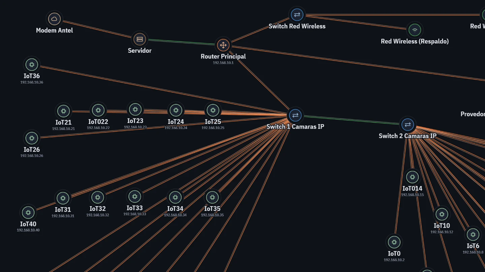

# Trenza

Visor web de sólo lectura para archivos `.pkt` y `.pka` de Cisco Packet Tracer y capturas `.pcap` y `.pcapng`. Descifra el archivo y dibuja la topología en el navegador; el archivo no se sube a ningún servidor.

**Demo:** [trenza.pages.dev/demo](https://trenza.pages.dev/demo) abre una red de ejemplo de 71 equipos.



## Qué hace

Con un `.pkt` o `.pka`:

- Dibuja la topología lógica con las posiciones guardadas en el archivo.
- Muestra cada equipo con sus interfaces y direcciones, VLAN, rutas estáticas, protocolos de enrutamiento (RIP, OSPF, EIGRP), listas de acceso y la `running-config`.
- Exporta el diagrama como PNG, JPG, SVG o PDF, en inglés o español y con tema claro u oscuro.

Con un `.pcap` o `.pcapng`:

- Lista los paquetes con tiempo, direcciones y protocolo, con filtro y orden por columna.
- Desglosa cada paquete por capas y muestra el volcado hexadecimal.
- Exporta la captura, o los paquetes seleccionados, como CSV o pcap.

No edita ni simula nada: para eso sigue haciendo falta Packet Tracer.

## Uso

- Abrir un archivo con el botón o arrastrándolo a la página.
- `?src=<url>` abre un archivo publicado en otro sitio, si ese servidor permite CORS (por ejemplo `raw.githubusercontent.com`). Sólo se aceptan direcciones `https`.
- `/demo` abre la red de ejemplo de `showcase/`. La portada también ofrece una captura de ejemplo.
- Funciona sin conexión después de la primera visita y se puede instalar como aplicación.

## Cómo se lee un `.pkt`

El formato no está documentado. Desde la versión 6.2, Packet Tracer guarda el XML interno así, y el visor deshace los pasos en orden inverso:

1. Ofuscación exterior: el archivo invertido y cada byte con XOR contra un valor que depende de la posición y del largo.
2. Twofish en modo EAX, con clave y nonce fijos: 16 bytes `0x89` y 16 bytes `0x10`.
3. Ofuscación interior: otra máscara por posición sobre el texto descifrado.
4. zlib, con el tamaño descomprimido en los primeros 4 bytes.

Los archivos anteriores a 6.2 sólo tienen los pasos 3 y 4. El formato lo documentaron antes [pka2xml](https://github.com/mircodz/pka2xml) y [ptexplorer](https://github.com/axcheron/ptexplorer); Trenza reimplementa la lectura en JavaScript para que corra en el navegador. Twofish está escrito a mano porque WebCrypto no lo incluye, y se prueba contra los vectores del paper original.

El resto de los datos sale del XML y de la `running-config` de cada equipo. Las VLAN, por ejemplo, hay que cruzarlas: el XML guarda número y nombre, y la configuración dice qué puerto pertenece a cuál.

## Desarrollo

No hay dependencias ni paso de compilación: son módulos ES servidos tal cual.

```bash
npm test
```

Las pruebas (46, con `node:test`) cubren el descifrado, los parsers de pcap y de configuración IOS, el reparto del diagrama, las traducciones y los dos archivos de ejemplo. Para probar en el navegador alcanza con servir la carpeta con cualquier servidor estático; abriendo `index.html` desde el disco los módulos no cargan.

```
src/
  app.js        estado de la aplicación y conexión entre vistas
  i18n.js       textos en inglés y español
  pkt/          descifrado (twofish, eax, decode) y modelo de red (model, config)
  pcap/         lectura de capturas, disección por capas y exportación
  view/         diagrama, reparto de etiquetas, exportación, inspector, tabla de paquetes
sw.js           caché para uso sin conexión
scripts/        generador de la captura de ejemplo
test/           pruebas con node:test
```

Se despliega en Cloudflare Pages sin comando de compilación. `_headers` define la política de seguridad de contenido: todo tiene que venir del mismo origen y el script en línea del `<head>` va con hash, así que si se modifica hay que recalcular el `sha256` en `_headers`.

Las decisiones de diseño, con lo que se midió para tomarlas, están en [`docs/decisiones.md`](docs/decisiones.md).

## Compatibilidad

Safari 16.4, Chrome 80 y Firefox 113 en adelante. El límite lo pone `DecompressionStream`, que es lo que descomprime el `.pkt`.

Está probado con archivos de Packet Tracer 7.3.0, 7.3.1, 8.2.1 y 9.0.1 (14 redes de entre 3 y 72 equipos). Falta probar archivos reales de las versiones 6.2 a 7.2 y del formato anterior a 6.2, que sólo se probó con archivos generados. Las listas de acceso se probaron con configuraciones escritas a mano, porque ninguno de los archivos reales tenía una.

## Licencia

El código es MIT (ver `LICENSE`).

La tipografía de `fonts/` es IBM Plex, bajo la SIL Open Font License 1.1 (`fonts/LICENSE.txt`). La red de `showcase/` es un trabajo propio de un curso de redes. La captura de ejemplo es sintética: la arma `scripts/captura-ejemplo.mjs` con direcciones reservadas para documentación, así que no sale de ninguna red real.

Trenza es un proyecto independiente, sin relación con Cisco ni respaldo de su parte. Cisco y Packet Tracer son marcas registradas de Cisco Systems, Inc. El proyecto no incluye software, iconos ni contenido de Cisco: los símbolos del diagrama son propios.
